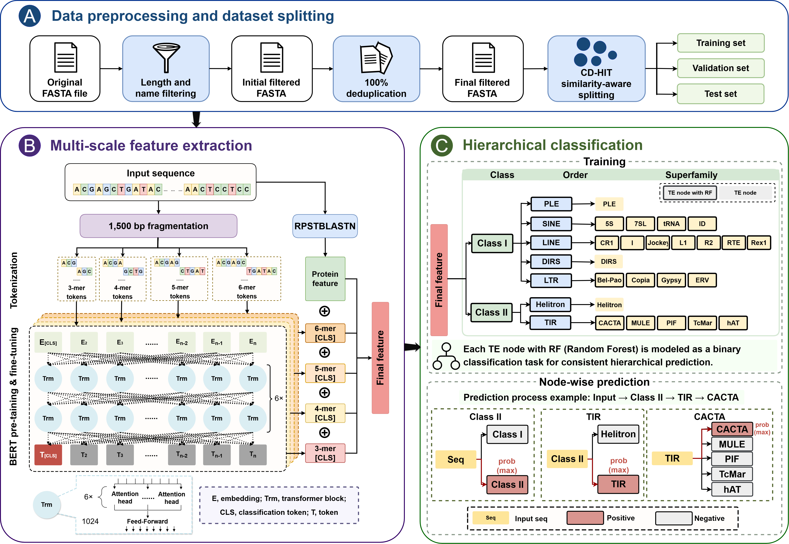

# BERTE Train and Test Pipeline

BERTE is a computational workflow for transposable element classification. It combines multi-scale 3-mer to 6-mer BERTE sequence embeddings, CDD protein-domain features, and a hierarchical Random Forest classifier to predict transposable element class, order, and superfamily.

## Model Workflow



This document provides the standard command-line workflow for BERTE model training and test-time inference. Run all commands from the repository root.

## Pretrained Model Files

The four fine-tuned BERTE models are included in `models/`:

```text
models/berte_3mer_finetuned.h5
models/berte_4mer_finetuned.h5
models/berte_5mer_finetuned.h5
models/berte_6mer_finetuned.h5
```

The hierarchical RF model is distributed separately through Zenodo because `models/RF.pkl` is larger than GitHub's single-file size limit. Before running the test prediction step, download `RF.pkl` from the Zenodo record and save it as:

```text
models/RF.pkl
```

Zenodo DOI:

```text
https://doi.org/10.5281/zenodo.22120261
```

Input FASTA headers must use the following labelled format:

```text
>sequence_id|superfamily|database
ACGT...
```

## 1. Create the Conda Environment

This step creates the software environment required for BERTE, TensorFlow, and RPSTBLASTN.

The computational environment used in this study is:

```text
GPU: NVIDIA GeForce RTX 4090, 24564 MiB
Driver: 525.116.04
Python: 3.8.20
TensorFlow: 2.6.0
```

The repository `environment.yml` pins the compatible software stack, including:

```text
python=3.8
cudatoolkit=11.2
cudnn=8.1
blast=2.17
tensorflow==2.6.0
keras==2.6.0
```

Create and activate the environment:

```bash
conda env create -f environment.yml
conda activate berte
```

Check TensorFlow and RPSTBLASTN:

```bash
python -c "import tensorflow as tf; print(tf.__version__, tf.config.list_physical_devices('GPU'))"
rpstblastn -version
```

## 2. Model Test Workflow

The test workflow uses models in `models/` and a labelled FASTA file.

Default input:

```text
input_fasta/demo_test.fasta
```

Executable shortcut:

After the Conda environment is installed and `models/RF.pkl` has been downloaded from the Zenodo record, run the complete inference pipeline with:

```bash
bash run_test_pipeline.sh
```

The script uses `input_fasta/demo_test.fasta` by default and reproduces Sections 2.1-2.6, writing outputs to `outputs/test_pipeline/`. It sets `HDF5_USE_FILE_LOCKING=FALSE` by default to avoid HDF5 locking errors on shared file systems. Optional environment variables can override defaults, for example:

```bash
INPUT_FASTA=input_fasta/demo_test.fasta GPU_ID=0 THREADS=4 bash run_test_pipeline.sh
```

### 2.1 Create Test Output Directories

This step creates the working directories used by the test pipeline.

```bash
mkdir -p outputs/test_pipeline/work_data_1500bp
mkdir -p outputs/test_pipeline/logs
mkdir -p outputs/test_pipeline/protein_outputs
```

### 2.2 Preprocess the Test FASTA

This step fragments long test sequences and writes the fragment-level labels and headers used by downstream BERTE embedding extraction.

```bash
python -u code/preprocessing/preprocess_test_fasta.py input_fasta/demo_test.fasta \
  --fragment-size 1500 \
  --output-dir outputs/test_pipeline/work_data_1500bp \
  --prefix test
```

Arguments:

| Argument | Default | Meaning |
|---|---:|---|
| `fasta` | Required | Labelled input FASTA. |
| `--fragment-size`, `-l` | `1500` | Maximum fragment length. Sequences longer than this value are split into multiple fragments. |
| `--output-dir`, `-o` | `.` | Directory for fragment files, labels, headers, and summary files. |
| `--prefix`, `-p` | `test` | Output filename prefix used by downstream steps. |
| `--allow-bad-headers` | `False` | Allow malformed FASTA headers. This is not recommended for labelled evaluation. |

Expected outputs:

```text
outputs/test_pipeline/work_data_1500bp/test_fragments.json
outputs/test_pipeline/work_data_1500bp/test_fragment_superfamilies.txt
outputs/test_pipeline/work_data_1500bp/test_fragment_headers.txt
outputs/test_pipeline/work_data_1500bp/test_fragments.fasta
outputs/test_pipeline/work_data_1500bp/test_sequences.fasta
outputs/test_pipeline/work_data_1500bp/test_sequence_headers.txt
outputs/test_pipeline/work_data_1500bp/test_preprocess_summary.tsv
```

### 2.3 Extract CDD Protein-Domain Features

This step runs RPSTBLASTN on the original test FASTA and converts CDD hits into protein-domain feature vectors.

Run RPSTBLASTN directly on the original FASTA file.

```bash
python -u code/cdd_features/extract_cdd_features.py \
  -i input_fasta/demo_test.fasta \
  -d CDD/RPSTBLASTN_LIB/db_large.pn \
  -t 4 \
  --out1 outputs/test_pipeline/protein_outputs/test_cdd_raw_hits.tsv \
  --out2 outputs/test_pipeline/work_data_1500bp/test_cdd_features.txt
```

Arguments:

| Argument | Default | Meaning |
|---|---:|---|
| `--fastaFile`, `-i` | Required | FASTA file used as the RPSTBLASTN query. Use the original input FASTA. |
| `--db`, `-d` | `CDD/RPSTBLASTN_LIB/db_large.pn` | CDD `.pn` database list. The script removes `.pn` internally when calling RPSTBLASTN. |
| `--threads`, `-t` | `1` | CPU thread count for RPSTBLASTN. |
| `--out1` | `out1` | Raw RPSTBLASTN hit output path or filename suffix. |
| `--out2` | `out2` | Final CDD protein-domain feature output path or filename suffix. |
| `--timestamp` | `False` | Prefix outputs with a timestamp. |

Expected output:

```text
outputs/test_pipeline/work_data_1500bp/test_cdd_features.txt
```

### 2.4 Export 3-mer to 6-mer BERTE Embeddings

This step uses the fine-tuned 3-mer, 4-mer, 5-mer, and 6-mer BERTE models to export NSP-Dense embeddings for each test fragment.

```bash
CUDA_VISIBLE_DEVICES=0 python -u code/finetuning/extract_berte_embeddings.py \
  models/berte_3mer_finetuned.h5 \
  outputs/test_pipeline/work_data_1500bp \
  --prefix test \
  --k 3 \
  --stride 3 \
  --batch_size 32 \
  --seq_len 502 \
  --output outputs/test_pipeline/work_data_1500bp/test_3mer_embeddings.pkl
```

```bash
CUDA_VISIBLE_DEVICES=0 python -u code/finetuning/extract_berte_embeddings.py \
  models/berte_4mer_finetuned.h5 \
  outputs/test_pipeline/work_data_1500bp \
  --prefix test \
  --k 4 \
  --stride 4 \
  --batch_size 32 \
  --seq_len 502 \
  --output outputs/test_pipeline/work_data_1500bp/test_4mer_embeddings.pkl
```

```bash
CUDA_VISIBLE_DEVICES=0 python -u code/finetuning/extract_berte_embeddings.py \
  models/berte_5mer_finetuned.h5 \
  outputs/test_pipeline/work_data_1500bp \
  --prefix test \
  --k 5 \
  --stride 5 \
  --batch_size 32 \
  --seq_len 502 \
  --output outputs/test_pipeline/work_data_1500bp/test_5mer_embeddings.pkl
```

```bash
CUDA_VISIBLE_DEVICES=0 python -u code/finetuning/extract_berte_embeddings.py \
  models/berte_6mer_finetuned.h5 \
  outputs/test_pipeline/work_data_1500bp \
  --prefix test \
  --k 6 \
  --stride 6 \
  --batch_size 32 \
  --seq_len 502 \
  --output outputs/test_pipeline/work_data_1500bp/test_6mer_embeddings.pkl
```

Arguments:

| Argument | Default | Meaning |
|---|---:|---|
| `model` | Required | Fine-tuned BERTE `.h5` model for the current k-mer scale. |
| `fragments_dir` | Required | Directory containing `<prefix>_fragments.json` from preprocessing. |
| `--prefix` | `test` | Split prefix used to find `<prefix>_fragments.json`. |
| `--k` | Required | K-mer size. Run with `3`, `4`, `5`, and `6`. |
| `--stride` | Required | Tokenization stride. Use the same value as `--k`. |
| `--batch_size` | `32` | Prediction batch size for exporting NSP-Dense embeddings. |
| `--seq_len` | `502` | Requested sequence token length. If larger than the model limit, the script uses the model limit. |
| `--output` | `None` | Output embedding pickle path. If omitted, writes `<prefix>_<k>mer_embeddings.pkl` under `fragments_dir`. |

Expected embedding files:

```text
outputs/test_pipeline/work_data_1500bp/test_3mer_embeddings.pkl
outputs/test_pipeline/work_data_1500bp/test_4mer_embeddings.pkl
outputs/test_pipeline/work_data_1500bp/test_5mer_embeddings.pkl
outputs/test_pipeline/work_data_1500bp/test_6mer_embeddings.pkl
```

### 2.5 Download the Hierarchical RF Model

This step obtains the pretrained hierarchical RF model that is distributed separately from the GitHub repository through Zenodo.

Download `RF.pkl` from the Zenodo record and save it under `models/`:

```text
https://doi.org/10.5281/zenodo.22120261
```

Check that the file is available at the expected path:

```bash
mkdir -p models
test -s models/RF.pkl
```

Expected output:

```text
models/RF.pkl
```

### 2.6 Predict with the Hierarchical RF Model

This step combines BERTE embeddings and CDD features, then predicts class, order, and superfamily with the trained hierarchical RF model.

Before running this command, make sure the Zenodo-downloaded RF model is available as `models/RF.pkl`.

```bash
python -u code/hierarchical_classifier/predict_hierarchical_rf.py \
  models/RF.pkl \
  outputs/test_pipeline/work_data_1500bp \
  --filePDB CDD/RPSTBLASTN_LIB/db_large.pn \
  --split test \
  --save_name berte_predictions \
  --output_dir outputs/test_pipeline \
  --threads 4 \
  --store_predictions
```

Arguments:

| Argument | Default | Meaning |
|---|---:|---|
| `model_path` | Required | Trained hierarchical RF model, for example `models/RF.pkl`. |
| `fragments_dir` | Required | Work directory containing embeddings, CDD features, fragment labels, and fragment headers. |
| `--filePDB` | Required | CDD `.pn` list used to determine the protein-domain feature count. |
| `--split` | `test` | Split prefix used to load `test_*` intermediate files. |
| `--save_name` | `berte_rf_model_test` | Output filename prefix. |
| `--output_dir` | `.` | Directory for prediction tables, metrics, and serialized results. |
| `--threads` | `1` | CPU cores used by each Random Forest node model. Use `-1` for all available cores. |
| `--store_predictions` | `False` | Save the predictions results. |

Final outputs:

```text
outputs/test_pipeline/berte_predictions_sequence_predictions.tsv
outputs/test_pipeline/berte_predictions_metrics.tsv
outputs/test_pipeline/berte_predictions.pkl
outputs/test_pipeline/berte_predictions.joblib
```

To use another labelled FASTA, replace these path fragments consistently:

```text
input_fasta/demo_test.fasta -> input_fasta/my_test.fasta
outputs/test_pipeline -> outputs/my_test
```

Keep `--prefix test` unless all downstream `test_*` intermediate filenames are also renamed consistently.

## 3. Model Training Workflow

Training data are not distributed with this repository. Prepare labelled train, validation, and test FASTA files before running this workflow.

Recommended input paths:

```text
input_fasta/train.fasta
input_fasta/val.fasta
input_fasta/test.fasta
```

For paper-comparable evaluation, prepare train, validation, and test splits with a similarity-aware strategy before running BERTE.

### 3.1 Create Training Output Directories

This step creates the work, protein-feature, model, and result directories used by the training pipeline.

```bash
mkdir -p outputs/train_pipeline/work_data_1500bp
mkdir -p outputs/train_pipeline/protein_outputs
mkdir -p outputs/train_pipeline/results/k3mer/pretrain
mkdir -p outputs/train_pipeline/results/k4mer/pretrain
mkdir -p outputs/train_pipeline/results/k5mer/pretrain
mkdir -p outputs/train_pipeline/results/k6mer/pretrain
mkdir -p outputs/train_pipeline/results/k3mer/finetune
mkdir -p outputs/train_pipeline/results/k4mer/finetune
mkdir -p outputs/train_pipeline/results/k5mer/finetune
mkdir -p outputs/train_pipeline/results/k6mer/finetune
mkdir -p outputs/train_pipeline/results/rf_classification
mkdir -p outputs/train_pipeline/trained_models
```

### 3.2 Preprocess Train, Validation, and Test FASTA

This step fragments the user-provided train, validation, and test FASTA files while preserving sequence order for later CDD-feature alignment.

These commands fragment sequences longer than 1,500 bp and write fragment-level labels and headers. Keep the original sequence order so that sequence-level CDD features align with averaged BERTE embeddings.

```bash
python -u code/preprocessing/preprocess_training_fasta.py input_fasta/train.fasta \
  --fragment-size 1500 \
  --output-dir outputs/train_pipeline/work_data_1500bp \
  --prefix train \
  --no-shuffle
```

```bash
python -u code/preprocessing/preprocess_training_fasta.py input_fasta/val.fasta \
  --fragment-size 1500 \
  --output-dir outputs/train_pipeline/work_data_1500bp \
  --prefix val \
  --no-shuffle
```

```bash
python -u code/preprocessing/preprocess_training_fasta.py input_fasta/test.fasta \
  --fragment-size 1500 \
  --output-dir outputs/train_pipeline/work_data_1500bp \
  --prefix test \
  --no-shuffle
```

Arguments:

| Argument | Default | Meaning |
|---|---:|---|
| `fasta` | Required | One or more labelled input FASTA files. |
| `--fragment-size`, `-l` | `1500` | Maximum fragment length. Longer sequences are split into fixed-size fragments. |
| `--output-dir`, `-o` | Input FASTA directory | Directory for fragment JSON files, fragment labels, and fragment headers. |
| `--prefix`, `-p` | FASTA stem | Output filename prefix. Use `train`, `val`, and `test` in this workflow. |
| `--seed` | `42` | Random seed used only when `--shuffle` is enabled. |
| `--shuffle` | `False` | Shuffle records before fragmentation. Do not use this in the standard workflow. |
| `--no-shuffle` | `True` | Keep original FASTA order. Required for direct CDD feature alignment. |
| `--allow-bad-headers` | `False` | Skip malformed FASTA headers instead of raising an error. Not recommended for training. |

Expected files include:

```text
outputs/train_pipeline/work_data_1500bp/train_fragments.json
outputs/train_pipeline/work_data_1500bp/train_fragment_superfamilies.txt
outputs/train_pipeline/work_data_1500bp/train_fragment_headers.txt
outputs/train_pipeline/work_data_1500bp/class1_train_fragments.json
outputs/train_pipeline/work_data_1500bp/class1_train_fragment_superfamilies.txt
outputs/train_pipeline/work_data_1500bp/class2_train_fragments.json
outputs/train_pipeline/work_data_1500bp/class2_train_fragment_superfamilies.txt
```

The same pattern is generated for `val` and `test`.

### 3.3 Extract CDD Protein-Domain Features

This step extracts CDD protein-domain features from each original train, validation, and test FASTA split.

Run RPSTBLASTN directly on each original FASTA file.

```bash
python -u code/cdd_features/extract_cdd_features.py \
  -i input_fasta/train.fasta \
  -d CDD/RPSTBLASTN_LIB/db_large.pn \
  -t 4 \
  --out1 outputs/train_pipeline/protein_outputs/train_cdd_raw_hits.tsv \
  --out2 outputs/train_pipeline/work_data_1500bp/train_cdd_features.txt
```

```bash
python -u code/cdd_features/extract_cdd_features.py \
  -i input_fasta/val.fasta \
  -d CDD/RPSTBLASTN_LIB/db_large.pn \
  -t 4 \
  --out1 outputs/train_pipeline/protein_outputs/val_cdd_raw_hits.tsv \
  --out2 outputs/train_pipeline/work_data_1500bp/val_cdd_features.txt
```

```bash
python -u code/cdd_features/extract_cdd_features.py \
  -i input_fasta/test.fasta \
  -d CDD/RPSTBLASTN_LIB/db_large.pn \
  -t 4 \
  --out1 outputs/train_pipeline/protein_outputs/test_cdd_raw_hits.tsv \
  --out2 outputs/train_pipeline/work_data_1500bp/test_cdd_features.txt
```

Arguments:

| Argument | Default | Meaning |
|---|---:|---|
| `--fastaFile`, `-i` | Required | FASTA file used as the RPSTBLASTN query. Use the original split FASTA. |
| `--db`, `-d` | `CDD/RPSTBLASTN_LIB/db_large.pn` | CDD `.pn` database list. The script removes `.pn` internally when calling RPSTBLASTN. |
| `--threads`, `-t` | `1` | CPU thread count for RPSTBLASTN. |
| `--out1` | `out1` | Raw RPSTBLASTN hit output path or filename suffix. |
| `--out2` | `out2` | Final CDD protein-domain feature output path or filename suffix. |
| `--timestamp` | `False` | Prefix outputs with a timestamp. |

### 3.4 Pretrain 3-mer to 6-mer BERTE Models

This step pretrains separate BERTE models for 3-mer, 4-mer, 5-mer, and 6-mer tokenizations using only the training fragments.

```bash
CUDA_VISIBLE_DEVICES=0 python -u code/pretraining/pretrain_berte.py outputs/train_pipeline/work_data_1500bp \
  --kmer 3 --batch_size 32 --seq_len 502 --no_balance \
  --head_num 5 --transformer_num 6 --embed_dim 250 --feed_forward_dim 1024 \
  --dropout_rate 0.05 --name outputs/train_pipeline/results/k3mer/pretrain/berte_pretrain_1500_3mer \
  --epochs 10
```

```bash
CUDA_VISIBLE_DEVICES=0 python -u code/pretraining/pretrain_berte.py outputs/train_pipeline/work_data_1500bp \
  --kmer 4 --batch_size 32 --seq_len 502 --no_balance \
  --head_num 5 --transformer_num 6 --embed_dim 250 --feed_forward_dim 1024 \
  --dropout_rate 0.05 --name outputs/train_pipeline/results/k4mer/pretrain/berte_pretrain_1500_4mer \
  --epochs 10
```

```bash
CUDA_VISIBLE_DEVICES=0 python -u code/pretraining/pretrain_berte.py outputs/train_pipeline/work_data_1500bp \
  --kmer 5 --batch_size 32 --seq_len 502 --no_balance \
  --head_num 5 --transformer_num 6 --embed_dim 250 --feed_forward_dim 1024 \
  --dropout_rate 0.05 --name outputs/train_pipeline/results/k5mer/pretrain/berte_pretrain_1500_5mer \
  --epochs 10
```

```bash
CUDA_VISIBLE_DEVICES=0 python -u code/pretraining/pretrain_berte.py outputs/train_pipeline/work_data_1500bp \
  --kmer 6 --batch_size 32 --seq_len 502 --no_balance \
  --head_num 5 --transformer_num 6 --embed_dim 250 --feed_forward_dim 1024 \
  --dropout_rate 0.05 --name outputs/train_pipeline/results/k6mer/pretrain/berte_pretrain_1500_6mer \
  --epochs 10
```

Arguments:

| Argument | Default | Meaning |
|---|---:|---|
| `fragments_dir` | Required | Work directory containing `class1_*` and `class2_*` fragment files. |
| `--nr_seqs` | `300000` | Maximum number of fragments sampled per class when balancing is enabled. |
| `--seq_len` | `502` | BERT token sequence length. |
| `--kmer` | `3` | K-mer size. Run with `3`, `4`, `5`, and `6`. |
| `--batch_size` | `32` | Pretraining batch size. |
| `--head_num` | `5` | Number of attention heads. |
| `--transformer_num` | `6` | Number of Transformer blocks. |
| `--embed_dim` | `250` | Token embedding dimension. |
| `--feed_forward_dim` | `1024` | Feed-forward layer dimension. |
| `--dropout_rate` | `0.05` | Dropout rate. |
| `--epochs` | `10` | Pretraining epochs. |
| `--no_balance` | `True` | Use all available class fragments without class balancing. |
| `--name` | `berte_pretrained` | Output model prefix. Final model is saved as `<name>_trained.h5`. |

### 3.5 Fine-Tune 3-mer to 6-mer BERTE Models

This step fine-tunes each pretrained BERTE model for class, order, and superfamily prediction and exports the RF-ready embeddings.

Fine-tuning writes stable, non-timestamped RF embedding files directly to `outputs/train_pipeline/work_data_1500bp`.

```bash
CUDA_VISIBLE_DEVICES=0 python -u code/finetuning/finetune_berte.py \
  outputs/train_pipeline/results/k3mer/pretrain/berte_pretrain_1500_3mer_trained.h5 \
  outputs/train_pipeline/work_data_1500bp \
  --batch_size 32 --epochs 4 --k 3 --stride 3 \
  --save_name outputs/train_pipeline/results/k3mer/finetune/berte_3mer_finetuned
```

```bash
CUDA_VISIBLE_DEVICES=0 python -u code/finetuning/finetune_berte.py \
  outputs/train_pipeline/results/k4mer/pretrain/berte_pretrain_1500_4mer_trained.h5 \
  outputs/train_pipeline/work_data_1500bp \
  --batch_size 32 --epochs 4 --k 4 --stride 4 \
  --save_name outputs/train_pipeline/results/k4mer/finetune/berte_4mer_finetuned
```

```bash
CUDA_VISIBLE_DEVICES=0 python -u code/finetuning/finetune_berte.py \
  outputs/train_pipeline/results/k5mer/pretrain/berte_pretrain_1500_5mer_trained.h5 \
  outputs/train_pipeline/work_data_1500bp \
  --batch_size 32 --epochs 4 --k 5 --stride 5 \
  --save_name outputs/train_pipeline/results/k5mer/finetune/berte_5mer_finetuned
```

```bash
CUDA_VISIBLE_DEVICES=0 python -u code/finetuning/finetune_berte.py \
  outputs/train_pipeline/results/k6mer/pretrain/berte_pretrain_1500_6mer_trained.h5 \
  outputs/train_pipeline/work_data_1500bp \
  --batch_size 32 --epochs 4 --k 6 --stride 6 \
  --save_name outputs/train_pipeline/results/k6mer/finetune/berte_6mer_finetuned
```

Arguments:

| Argument | Default | Meaning |
|---|---:|---|
| `pretrained_bert` | Required | Pretrained BERTE `.h5` model from the previous step. |
| `fragments_dir` | Required | Work directory containing `train`, `val`, and `test` fragment files. |
| `--seq_len` | `502` | Requested token sequence length. |
| `--k` | `3` | K-mer size. Match the pretrained model. |
| `--stride` | `3` | Tokenization stride. Use the same value as `--k`. |
| `--batch_size` | `32` | Fine-tuning batch size. |
| `--epochs` | `4` | Fine-tuning epochs. |
| `--nr_seqs` | `100000000` | Maximum number of fragments loaded from each split. |
| `--learning_rate` | `5e-5` | Fine-tuning learning rate. |
| `--save_name` | `None` | Output model prefix. Final model is saved as `<save_name>.h5`. |
| `--store_predictions` | `False` | Store voted test predictions and print balanced accuracy only. |
| `--only_test_model` | `False` | Evaluate an existing model without training. |
| `--export_embeddings_only` | `False` | Load an existing fine-tuned model, export train/val/test embeddings to `fragments_dir`, and exit. |

`--only_test_model` and `--export_embeddings_only` are mutually exclusive.

Required RF embedding outputs:

```text
outputs/train_pipeline/work_data_1500bp/train_3mer_embeddings.pkl
outputs/train_pipeline/work_data_1500bp/test_3mer_embeddings.pkl
```

The same filename pattern is used for 4-mer, 5-mer, and 6-mer models.

### 3.6 Optional: Re-Export Train, Validation, and Test Embeddings

This optional step regenerates train, validation, and test embeddings from existing fine-tuned BERTE models without retraining.

Use these commands only if the RF embedding files are missing, if you want to regenerate embeddings from existing fine-tuned models, or if you changed `--seq_len`, `--batch_size`, `--k`, or `--stride`.

```bash
CUDA_VISIBLE_DEVICES=0 python -u code/finetuning/finetune_berte.py outputs/train_pipeline/results/k3mer/finetune/berte_3mer_finetuned.h5 outputs/train_pipeline/work_data_1500bp --batch_size 32 --seq_len 502 --k 3 --stride 3 --export_embeddings_only
CUDA_VISIBLE_DEVICES=0 python -u code/finetuning/finetune_berte.py outputs/train_pipeline/results/k4mer/finetune/berte_4mer_finetuned.h5 outputs/train_pipeline/work_data_1500bp --batch_size 32 --seq_len 502 --k 4 --stride 4 --export_embeddings_only
CUDA_VISIBLE_DEVICES=0 python -u code/finetuning/finetune_berte.py outputs/train_pipeline/results/k5mer/finetune/berte_5mer_finetuned.h5 outputs/train_pipeline/work_data_1500bp --batch_size 32 --seq_len 502 --k 5 --stride 5 --export_embeddings_only
CUDA_VISIBLE_DEVICES=0 python -u code/finetuning/finetune_berte.py outputs/train_pipeline/results/k6mer/finetune/berte_6mer_finetuned.h5 outputs/train_pipeline/work_data_1500bp --batch_size 32 --seq_len 502 --k 6 --stride 6 --export_embeddings_only
```

Arguments:

| Argument | Default | Meaning |
|---|---:|---|
| `pretrained_bert` | Required | Existing fine-tuned BERTE `.h5` model for the current k-mer scale. |
| `fragments_dir` | Required | Work directory containing `train`, `val`, and `test` fragment files. Embeddings are written here. |
| `--batch_size` | `32` | Prediction batch size for exporting NSP-Dense embeddings. |
| `--seq_len` | `502` | Requested token sequence length. If larger than the model limit, the script uses the model limit. |
| `--k` | `3` | K-mer size. Run with `3`, `4`, `5`, and `6`. |
| `--stride` | `3` | Tokenization stride. Use the same value as `--k`. |
| `--export_embeddings_only` | `False` | Export `train/val/test_<k>mer_embeddings.pkl` from an existing model and exit. |

### 3.7 Train and Evaluate the Hierarchical RF Model

This step trains the hierarchical RF classifier from train BERTE embeddings and CDD features, then evaluates it on the held-out test split.

```bash
python -u code/hierarchical_classifier/train_hierarchical_rf.py \
  outputs/train_pipeline/work_data_1500bp \
  --filePDB CDD/RPSTBLASTN_LIB/db_large.pn \
  --save_name outputs/train_pipeline/results/rf_classification/RF \
  --threads 4 \
  --store_predictions
```

Arguments:

| Argument | Default | Meaning |
|---|---:|---|
| `fragments_dir` | Required | Work directory containing train/test embeddings, CDD features, labels, and fragment headers. |
| `--filePDB` | Required | CDD `.pn` list used to determine the protein-domain feature count. |
| `--save_name` | `RF` | Output model prefix. The model is saved as `<save_name>.pkl`. |
| `--threads` | `1` | CPU cores used by each Random Forest node model. Use `-1` for all available cores. |
| `--store_predictions` | `False` | Save the predictions results. |

Final outputs:

```text
outputs/train_pipeline/results/rf_classification/RF.pkl
outputs/train_pipeline/results/rf_classification/RF_predictions.pkl
```

Copy the trained BERTE `.h5` models into `models/` if the test workflow should use them as the default inference models. If you retrain the hierarchical RF model, keep the resulting `RF.pkl` outside the GitHub repository and distribute it separately, for example through Zenodo, then place it at `models/RF.pkl` for local inference.

## Citations

If you use BERTE, please cite:

```text
Yiqi Chen, Yang Qi, Yingfu Wu, Fuhao Zhang, Xingyi Li,
Xingyu Liao*, and Xuequn Shang*,. BERTE manuscript under submission.
```


